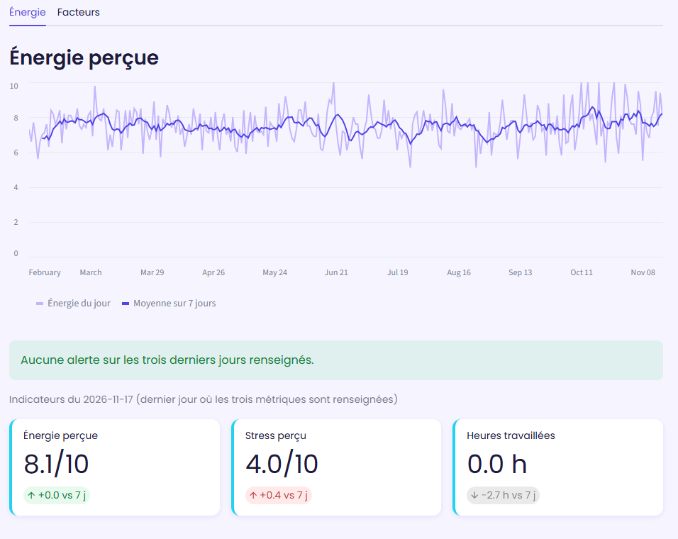
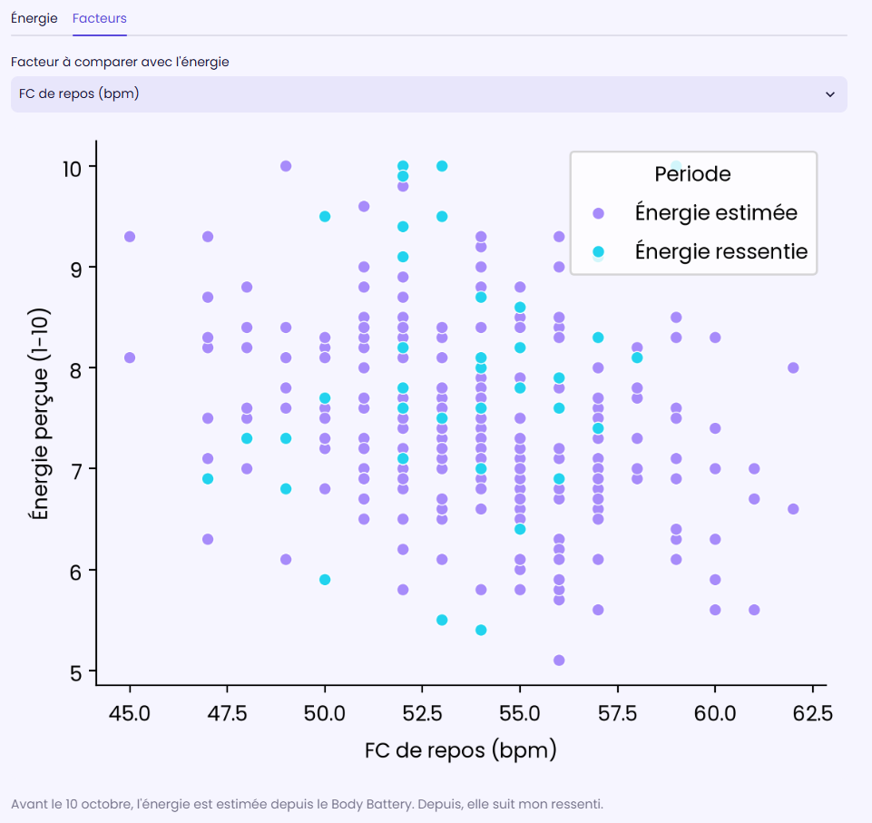

# Freelance Energy Tracker


**Live demo:** [TBD] (synthetic data, dashboard in French)



## Problem

Freelancers have no HR team and no occupational doctor. Nobody flags early signs of overwork before they turn into sick days or lost clients. Wearables collect a lot of data, but they say little about how you actually feel.

## Solution

A personal dashboard that crosses Garmin wearable data with a daily self-assessment log. It shows energy trends, raises an alert after three low-energy days in a row, and compares body signals with perceived feelings.

The dashboard reads a local Excel file and updates as soon as a new row is saved. No restart needed.

## Impact

- One screen to spot a low-energy streak before it becomes a problem.
- Shows which signals actually move with energy, and which do not.
- Reveals where the watch and personal feeling disagree, so the user does not rely on the watch alone.

## Key findings (personal data, 9 months)

- Sleep score and HRV are the signals most linked to energy (correlation 0.66 and 0.80).
- Workload in hours shows only a weak link with energy (0.25), even summed over 7 days.
- Perceived stress and Garmin stress are almost independent (0.07). Body and mind tell two different stories.
- Since self-rating replaced the watch-based estimate, felt energy follows Body Battery at 0.60 only.
- Energy is lower the day after a workout day, and the gap is statistically significant (Mann-Whitney, p < 0.001).

These are correlations from one person. They describe links, not causes.



## Privacy by design

Real data never leaves the user's computer. The Excel file is git-ignored. The public demo runs on a synthetic dataset generated by `src/make_demo_data.py`, which mimics the structure and main patterns of the real data without copying any day.

## Quick start

```bash
git clone https://github.com/meganemmladjyn-cmyk/freelance-energy-tracker-python.git
cd freelance-energy-tracker-python
pip install -r requirements.txt
streamlit run src/app.py
```

Without a personal Excel file in `data/raw/`, the app loads the demo dataset.

## Stack

| Layer | Tools |
|---|---|
| Data | pandas, NumPy, openpyxl |
| Analysis | marimo, SciPy, seaborn |
| Dashboard | Streamlit, matplotlib, custom CSS |

## Methodology

- Exploratory analysis in a marimo notebook: cleaning, descriptive stats, correlations, group comparisons.
- Non-parametric tests (Mann-Whitney) because energy is a 1 to 10 rating, not a normal variable.
- Spearman correlation for ordinal ratings.
- A documented break on October 10: energy was estimated from Body Battery before, and self-rated after.

## Contact

Built by Mégane Ladjyn, Data Marketing Analyst.
[LinkedIn](https://linkedin.com/in/megane-ladjyn)